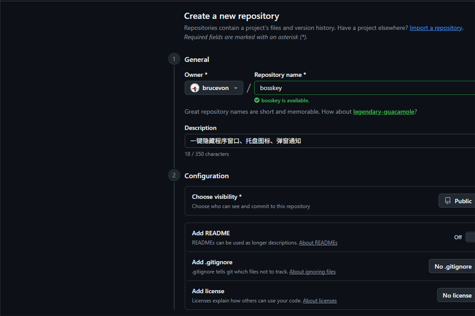

# BossKey

Windows 老板键工具：一键隐藏 / 恢复指定程序的痕迹。



## 功能

- **一键隐藏 / 显示目标**：隐藏指定程序的全部窗口（任务栏按钮与 Alt-Tab 项随之消失）与托盘图标，恢复时按原位置、最小化 / 最大化状态精确还原
- **自动识别**：窗口与托盘图标自动发现、一起处理；运行中应用列表（含仅托盘图标的应用）复选框勾选目标，支持搜索过滤与全选 / 反选
- **全局热键**：`Ctrl+Alt+H` 隐藏 / 显示目标，`Ctrl+Alt+B` 隐藏 / 显示 BossKey 本体（窗口 + 托盘图标）
- **后台守护**：关闭窗口即退居系统托盘继续值守；托盘菜单可呼出主窗口或退出（退出时自动恢复目标）
- **深浅双主题**：内置亮色 / 暗色主题一键切换
- 绿色单文件、免安装，配置保存在 exe 同目录

## 编译

环境要求：Windows 10 及以上、[Rust](https://rustup.rs)（MSVC 工具链）。

```powershell
cargo build --release
# 产物：target\release\bosskey.exe
```

可选：以 git tag 版本号打包重命名产物

```powershell
powershell -File scripts\release.ps1
# 产物：dist\BossKey-<版本>.exe
```

## 开源协议

本项目采用 [GPL-3.0](LICENSE) 协议开源：

- **可自由使用、修改、分发，包括商业用途**
- **商业分发必须公开完整源码**（GPL 传染性：任何分发——无论商用与否——均须随附源码）
